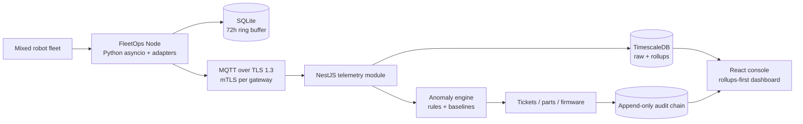

# FalconFleetOps architecture

FalconFleetOps is a modular monolith in front of a fleet of offline-first FleetOps Nodes. The web console is deliberately dashboard-first: the default page reads from 1-minute/1-hour rollups, while the robot detail page can request recent raw samples and evidence. Gateways normalize vendor protocols at the edge, run the cheap pre-filter locally, persist a 72-hour SQLite ring buffer, and backfill through MQTT when connectivity returns.

## Named decisions

| Decision | Choice | Why |
| --- | --- | --- |
| Time-series store | TimescaleDB | PostgreSQL transactions, row-level security and audit writes are first-class in v1; hypertables still provide fleet-scale time rollups. |
| Messaging | MQTT behind `TelemetryTransport` | Patchy warehouse Wi-Fi and embedded gateway support; a Kafka implementation can later satisfy the same interface. |
| Firmware rollback | Gateway safe mode + previous A/B slot | Vendor APIs vary, so the gateway owns signed image verification and rollback to a known-good partition; unsupported vendor apply paths create a technician alert rather than forcing an unsafe update. |
| Anomaly model | Rules + rolling baseline first | Every alert needs machine-readable evidence; `MLAnomalyModel` is the future plug-in boundary. |
| Offline storage | SQLite ring buffer | Predictable footprint on embedded Linux and easy backfill semantics; raw streams are not uploaded until connectivity resumes. |

## Data flow

1. `ROS2ZenohAdapter`, `MiRMqttAdapter` or `GenericCANAdapter` discovers an endpoint.
2. The adapter emits `FleetTelemetry` and the edge filter evaluates `WHEEL.MOTOR_TEMP_RAMP`, `CALL.BATT_CYCLE_COUNT_BASELINE`, `LIDAR.PACKET_LOSS_RATE` and `ENCODER.DRIFT`.
3. Raw 1Hz samples are cached locally and abnormal events are published to `fleet/{site_id}/robot/{robot_id}/telemetry/1hz` over TLS 1.3 MQTT with a per-gateway mTLS certificate.
4. The telemetry module writes raw samples, continuous aggregates and anomaly evidence; the nightly KPI job materializes fleet health and downtime cost metrics.
5. Ticket, parts, firmware and audit modules write through the same tenant-aware request context. Every portal action appends an audit event.

See [`schema.sql`](schema.sql), [`security.md`](security.md), and [`firmware.md`](firmware.md) for the concrete trust and persistence contracts.
